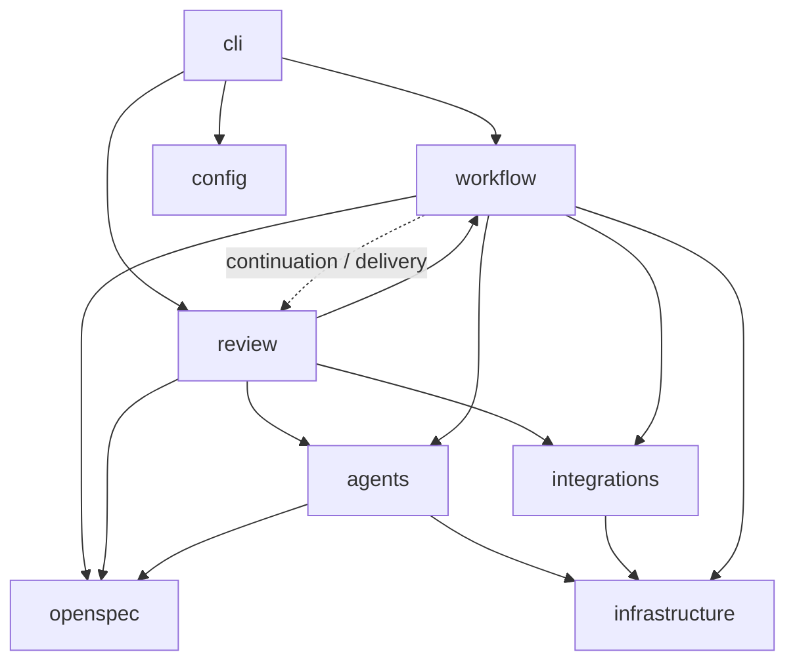

# Карта проекта

Harness управляет порядком работы и проверяет результаты. LLM запускается только
для конкретного этапа. Основные сценарии находятся в `src/workflow` и `src/review`;
остальные модули содержат контракты, ввод/вывод и правила работы с документами.

## Структура

```text
src/
  cli/              Команды терминала: аргументы, выполнение, вывод, часовое ожидание
  config/           Настройки и определение текущего репозитория
  domain/           Типы задачи, ролей, запусков, PR и проверка входных JSON
  agents/           Инструкции, запуск LLM CLI, проверка путей артефактов
  workflow/         Жизненный цикл задачи, этапы, проверки и публикация
  openspec/         Чтение документов, их валидация и владение изменениями
  review/           Наблюдение за PR, разбор тредов, коррекции и ответы
  integrations/     Скриптовый протокол, Bitbucket, уведомления трекера задач
  infrastructure/   Git, дочерние процессы, расположение ресурсов пакета

agents/
  common.md         Общий контракт всех ролей
  analysis/         analyst.md
  backend/          backend-planner.md, backend-implementer.md
  frontend/         frontend-planner.md, frontend-implementer.md
  testing/          tester.md
  review/           verifier.md, review-triager.md
  templates/        Обязательные разделы отчётов всех ролей и статусов
knowledge/          Конвенции фронта, бэка и тестирования
skills/             Инструкция маршрутизации по конвенциям
scripts/            Запускаемые демонстрации, заглушки и служебные команды
examples/           Примеры конфигурации, задач и тредов PR
tests/              Сценарии по тем же областям; общие фикстуры — в support/
docs/               Описание контрактов и пользовательских сценариев
```

`agents/` в корне — текст для модели; `src/agents/` — TypeScript, который его
загружает и запускает модель. Группы ролей и соответствующие им области
конвенций заданы в `src/agents/contracts.ts` и `src/agents/instructions.ts`; добавление новой роли
требует указать её группу. Идентификаторы ролей в запросах и state.json сохранены. `dist/` полностью генерируется сборкой.
`scripts/mock-integration.ts` остаётся точкой подключения ваших корпоративных API.
Расположение запускаемых скриптов сохранено, чтобы не менять команды адаптеров.

## Где начинать чтение

Восстановление прерванного запуска: `src/workflow/continuation.ts` проверяет
условия и блокировку; `checkpoint.ts` сохраняет границы этапов; `preparation.ts`
отвечает за worktree/setup. `pipeline.ts` выполняет сохранённую стадию, а
`agent-step.ts` восстанавливает контекст и номера попыток. Результат роли и
ссылка checkpoint.resultIndex сохраняются вместе, чтобы не повторять уже
зафиксированную роль при остановке перед переходом на следующий этап.
Учёт дочерних процессов в `infrastructure/process.ts` привязан к run через
AsyncLocalStorage. Пользовательский путь: [continuation.md](continuation.md).

| Что нужно понять или изменить | Начать здесь |
| --- | --- |
| Синтаксис CLI и набор команд | `src/cli/arguments.ts`, `src/cli/commands.ts` |
| Настройки и работа из текущего репозитория | `src/config/settings.ts` |
| Новый запуск, ответ аналитику, коррекция из PR | `src/workflow/lifecycle.ts` |
| Порядок ролей и две доработки | `src/workflow/pipeline.ts` |
| Вход роли, история контекста, логи и артефакты | `src/workflow/agent-step.ts` |
| Что именно проверяется перед одобрением | `src/workflow/checks.ts`, `src/workflow/verification.ts` |
| Коммит, push, создание PR, повтор доставки | `src/workflow/delivery.ts` |
| Состояние запуска и блокировка параллельного исполнения | `src/workflow/state.ts` |
| Содержимое отчёта и уведомление об окончании этапа | `src/workflow/reporting.ts` |
| Снимки OpenSpec и защита основных спецификаций | `src/openspec/documents.ts`, `src/openspec/publishing.ts` |
| Что разрешено менять каждой роли | `src/openspec/ownership.ts` |
| Условия завершения и остановки наблюдения за PR | `src/review/watcher.ts` |
| Поиск новых замечаний, дедупликация и маршрутизация | `src/review/threads.ts` |
| Вызов triager, исправление, доставка ответа | `src/review/triage.ts`, `corrections.ts`, `replies.ts` |
| JSON-контракт чтения PR | `src/integrations/bitbucket.ts` |
| Контракт скриптов и сообщение в трекер задач | `src/integrations/adapter.ts`, `task-tracker.ts` |
| История этапов и ошибок | `src/infrastructure/events.ts`, команда `events` |
| Имена отчётов и проверка их структуры | `src/agents/contracts.ts`, `result-contract.ts`, `agents/templates/` |
| Единый запуск роли и проверка её прав | `src/agents/step.ts` |
| Формат/ошибки вывода LLM CLI | `src/agents/runner.ts` |

## Направление зависимостей



Типы из `domain` используются всеми областями. Интеграции и инфраструктура не
импортируют workflow или review. `review` может запускать коррекцию через workflow.
Ядро pipeline и выполнение ролей не управляют циклом наблюдения. Точки оркестрации
continuation/delivery используют review для опроса и завершения ответа после
восстановленной доставки; это явная зависимость между этими областями.

## Выполнение задачи

`lifecycle.start` сохраняет входное ТЗ и готовит рабочую копию. `pipeline` управляет
анализом, планированием, реализацией и ревью. `AgentSession` собирает запросы ролей,
передаёт исполнение в общую функцию `executeAgentStep`. Она сохраняет доказательства,
проверяет права роли, неизменность файлов для read-only ролей и черновики OpenSpec. `checks` выполняет
объективные проверки; `delivery` допускает публикацию только для одобренных файлов.

`reporting` формирует Markdown, а `state` атомарно сохраняет JSON. Эти модули общие
для обычного запуска и наблюдения за PR. Формат state.json, имена артефактов,
команды CLI и протоколы адаптеров сохранены при рефакторинге.

## Обработка PR

`watcher.watchOnce` владеет блокировкой запуска и определяет, можно ли продолжать.
`threads` выбирает новые человеческие обсуждения и проверяет их актуальность.
`triage` вызывает роль только на чтение. `corrections` считает попытки и возвращает
работу в workflow. `replies` повторяет сохранённый ответ с прежним idempotencyKey только после
сверки PR, HEAD и версии обсуждения. Устаревшие ответы получают superseded.
При merge watcher завершает задачу; треды и PR сам не закрывает.

## Проверка изменений

```sh
npm run typecheck
npm test
npm run format:check
```

`npm run format` применяет Prettier. Проверка TypeScript также запрещает неиспользуемые
импорты и локальные объявления. Сборка сначала очищает dist, чтобы устаревшие
скомпилированные модули не попадали в пакет.

Тесты разделены по областям: cli, agents, config, integrations, openspec, workflow,
review. Общая подготовка проекта и mock-агентов находится в tests/support;
проверки поведения остаются в соответствующих сценариях.

При переносе кода обновляйте импорты, эту карту и пути запуска в bin/package.json.
Демонстрации `agent-harness demo` и `agent-harness demo-review` проверяют пакет
снаружи исходного проекта и помогают обнаружить ошибки путей к ресурсам.

## Источники решений

Что изучено в mini-swe-agent, OpenHands, PR-Agent и BMAD, что адаптировано у нас
и что оставлено без переноса: [upstream-patterns.md](upstream-patterns.md).
Журнал и команды диагностики описаны в [events.md](events.md).

Контракт артефактов, обязательные отчёты и правила передачи:
[artifacts.md](artifacts.md).
